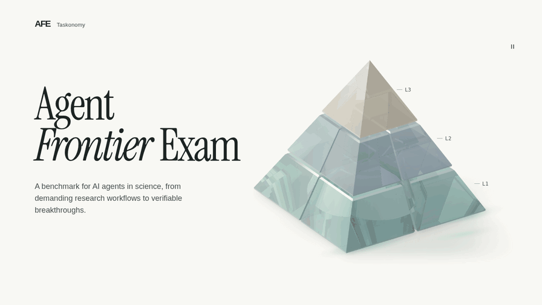

# Agent Frontier Exam

新官网的出版工作区。先评审读者会看到的首页、题目和共建路径，再决定第一版如何发行。网站使用英文、固定浅色。内部讨论使用中文，英文引文为拟用的界面文案。

## 看首屏

下面的动图展示旋转、上层轻抬、底层剖面和原位换卡。从 GitHub 打开[金字塔交互稿](review/pyramid-study.html)，用 **Download raw file** 下载后即可在浏览器离线操作。页面上的 **L1 section** 直达内圆三块，键盘可用 **Choose a block** 选择全部十二块。

[首屏大图](review/overview.png) · [L1 切面与选中态大图](review/selection.png)

## 出版文档

| 想讨论什么 | 从这里开始 |
| --- | --- |
| 第一次对外发行包含什么，分几轮看稿，何时适合开放访问 | [出版计划](docs/publication-plan.md) |
| L1、L2、L3 怎样解释，积木如何切开，选中后到底出现什么 | [首页与金字塔](docs/home-and-pyramid.md) |
| 任务、共建、署名与结果页各自回答什么，旧站哪些材料值得用 | [栏目与编辑说明](docs/pages-and-sources.md) |
| 已定的选择、当前进度与下一轮议题 | [项目现状](项目现状.md) |

本目录是新站的独立工作区，文档及评审样稿同步到 PrismaX-Team 的私有 GitHub 仓库。团队成员在仓库中即可看动图，亦可下载交互稿。正式域名与开放日期在审稿后决定。
