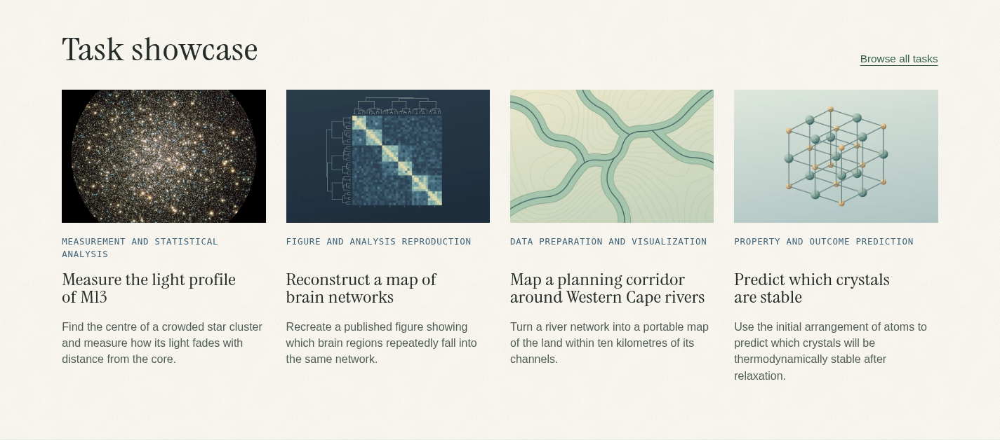

# Agent Frontier Exam

Agent Frontier Exam evaluates AI agents on scientific work, from demanding research workflows to verifiable breakthroughs. This repository contains the English, light-theme Taskonomy website and its editorial documentation.

**[Visit the Agent Frontier Exam website](https://prismax-team.github.io/AgentFrontierExam-Home/).** GitHub Pages publishes the site from this public repository. Each push to `main` builds the site, checks it and deploys the result.

For offline use, download `agent-frontier-exam-v0.1.html` from the [v0.1 release](https://github.com/PrismaX-Team/AgentFrontierExam-Home/releases/tag/v0.1.0). The release also includes a ZIP with the static site in its original directory structure.



## Explore the site

- Select a piece or its level label to bring that solid forward. L1 separates into seven research activities, including three sectors inside the base. L2 and L3 explain the goal and evidence for a breakthrough. Select either faded layer to reassemble the pyramid, or press Escape.
- Explore 16 task briefs by field and research activity. Four illustrated showcases lead to the same briefs as the directory. Each brief covers starting materials, the required deliverable and how success is assessed.
- Read the annotated Harbor task package guide, submit a workflow or breakthrough task through Duanyan ReX, or visit the authorship page for participant credit and area chair recruitment.

## Run locally

Use Node.js 24 and npm. The website has no external runtime or build dependencies.

```sh
npm run dev
```

Open `http://127.0.0.1:4173/`. To choose a port, run `npm run dev -- --port 8080`.

| Command | Output |
| --- | --- |
| `npm run build` | A static site in `dist/`, suitable for a domain root or a subdirectory |
| `npm run check` | Rebuilds the site and checks page links, anchors, illustrations and pyramid destinations |
| `npm run package:offline` | A complete, self-contained site in `dist-offline/agent-frontier-exam-v0.1.html` |

## Editorial documents

| Topic | Document |
| --- | --- |
| Release scope and publication process | [Publication plan](docs/publication-plan.md) |
| Scientific levels, pyramid geometry and interactions | [Homepage and pyramid](docs/home-and-pyramid.md) |
| Routes, community materials and sources | [Pages and editorial sources](docs/pages-and-sources.md) |
| Task selection, package provenance and scientific-level evidence | [Task card provenance](docs/task-selection.md) |
| Current edition and next editorial decisions | [项目现状](项目现状.md) |

The earlier [motion study](review/pyramid-motion.mp4) and [interactive design study](review/pyramid-study.html) document the evolution of the homepage. The [earlier AFE portal](https://prismax-team.github.io/AgentFrontierExam-Tasks/en/) has its own repository and release cycle.
