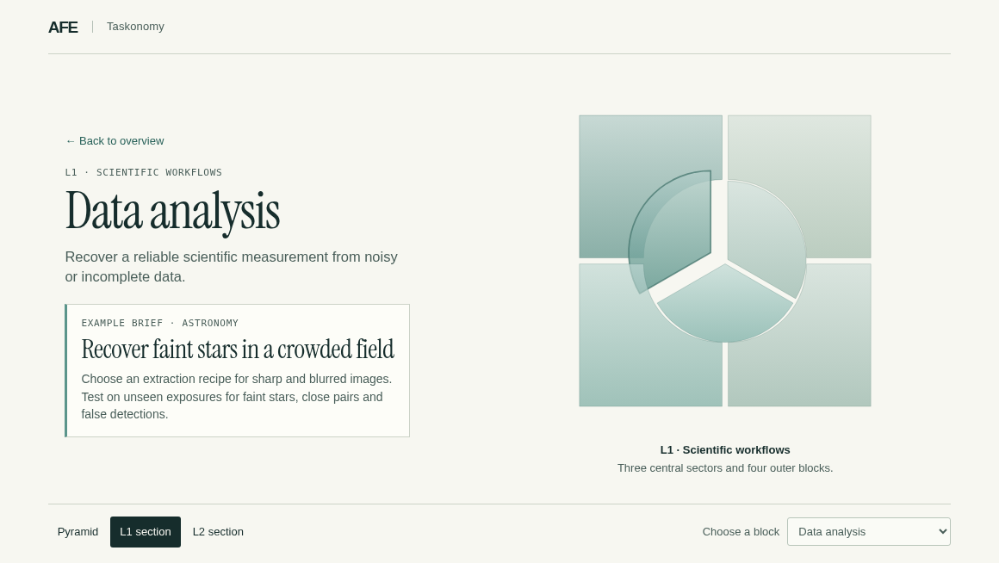

# 首页与金字塔

左边讲清楚 AFE 研究什么，右边让读者从一个科研目标进入一个具体任务。点选时沿用左侧的版面，把项目名与简介换成类别说明和一张任务卡。项目负责人已在本轮确认此构图，并选定 L1 的轻抬与俯视双入口。

## 第一眼看到什么

> **Agent Frontier Exam**
>
> A benchmark for AI agents in science, from demanding research workflows to open problems whose solutions could change a field.

这是第一轮英文样稿。视觉提案采用暖白纸色、深墨文字、轻细分隔线。标题用 Instrument Serif，正文用简洁的无衬线字体。金字塔是页面里色彩最丰富的对象。L1 用海绿色矿物色，L2 用偏蓝的玻璃色，L3 用淡琥珀色。同一层保留色差、接缝和独立轮廓，层级另有文字可读。日间英文是本版的底色和写作语言。

## 科学含义与几何

| 层 | 已确认的科学含义 | 本轮的剖面 |
| --- | --- | --- |
| L1 · Scientific workflows | 在指定条件下完成有挑战的科研流程。价值可以体现在选方法、用工具、分析证据和验证结果，任务目标完全不涉及科学突破。 | 底部方锥台。水平正方形内放同心圆，圆与四边有间隔。圆内按 120° 三等分，外环按 90° 四等分，每块延伸到正方形边界。 |
| L2 · Scientific breakthroughs | 针对一个尚未解决的科学问题，达到目标会构成可验证的科学突破。 | 中间方锥台，水平切面以两条穿过中心的垂线分成四个等面积象限。 |
| L3 · Major scientific breakthroughs | 达成目标会对相关领域带来重大进展，题目须能说明并验证其科学意义。 | 顶部完整方锥，一件积木。 |

科学层级按目标与验收定义。积木面积等分描述几何，各块可以收录不同数量的题。一项工作可能跨越多个科研活动。内圆与外圈只处理空间分割。控制板举出文献调研、数据分析、图表复现、专业软件操作等流程示例，尚待项目组确定完整子类。L2 的四个位置也尚无官方子类名。[控制板定义与 D44 的位置](pages-and-sources.md#权威资料)

## 从旋转到读题

| 读者动作 | 画面反馈 |
| --- | --- |
| 刚进入 | 斜上方看半透明方锥。三层之间保留细缝，绕垂直轴缓慢转动。可以暂停。 |
| 指向外侧一块 | 旋转停在当前位置。该块略微放大、外移，其余块保留整体轮廓。图旁给出块名及一句目标。移开后合拢。 |
| 靠近 L1 | 中、上层一起轻抬，露出底层接缝。明确的 **L1 section** 入口直接给出无上层遮挡的俯视图，可逐一指向或点击三个圆心扇块。L2 同样可以俯视。 |
| 点选任意块 | 保留金字塔和所选块。左侧原位出现层级、类别名、一句定义和一张题卡。正式版的卡片通向任务详情，同类浏览带上所选分类。 |
| 再选或返回 | 再选直接换题卡。**Back to overview** 或 Escape 恢复全名与简介。选中时阅读区保持静止。 |
| 使用手机、键盘或减少动态效果 | 轻触可直接选块，文字选择器可到达全部块。窄屏先显示标题或所选题卡，再显示图与切面入口。开启减少动态效果后使用静态视图与即时切换。 |

## 题卡究竟写什么

读者首先要知道任务需要什么科研判断。例卡选用天文图像中的暗星恢复。输入是不同清晰度的模拟天空图像，提交物是适应两种成像条件的提取方案，独立图像用来检验是否找回暗星、分开紧邻双星并控制误检。它说明流程题也可以有严格的科学验收。评审稿用这个例子讨论题卡，正式上架还需确定任务版本与公开范围。[上游题面的位置](pages-and-sources.md#权威资料)

其他块使用明确标记的说明性题卡。尤其是 L2 与 L3，评审题卡用假设情境展示“什么证据才够”，不给出正式题号或已产生突破的表述。正式发行时，每个对外题卡使用获准的真实题。尚无可公开例题的类别可保留目标说明和独立标注的教学例，待有真实题再加目录链接。

